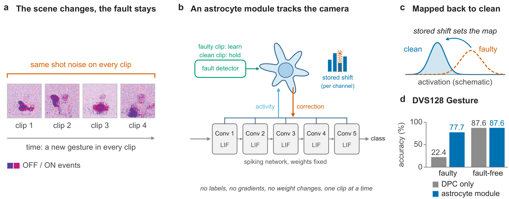

<div align="center">

# Fault-Tolerant Neuromorphic Event-Based Vision through an Astrocyte-Inspired Spiking Neural Network on FPGA

**Mohamad Yazan Sadoun<sup>1</sup>, Edris Zaman Farsa<sup>2</sup>, Sarah Sharif<sup>1</sup>, Yaser Mike Banad<sup>1,*</sup>**

<sup>1</sup>School of Electrical and Computer Engineering, University of Oklahoma, Norman, OK, USA  
<sup>2</sup>Embedded Computing Systems Group, Institute of Computer Engineering, Technische Universität Wien (TU Wien), Vienna, Austria

[](https://www.sciencedirect.com/journal/neurocomputing)
[](https://www.python.org/)
[](https://pytorch.org/)
[](fpga/rtl)
[](LICENSE)

</div>

<p align="center">
  
</p>

> **A sensor fault belongs to the camera, and it persists.**  
> This repository provides the reference PyTorch implementation of the **astrocyte-inspired regulatory memory**, **defective-pixel correction (DPC)**, the **event-C** sensor-fault benchmark (ten physical fault families at five calibrated severities), and the **fixed-point Verilog RTL** of the five-block DVS128 Gesture SNN and six-lane count-form astrocyte module co-implemented on an **AMD Kria KV260 FPGA**.

---

## Key Results

| Evaluation | Baseline | Astrocyte Module | Notes |
|---|---:|---:|---|
| **DVS128 Gesture** (2 backbones, event loss + raised threshold) | 22.41% (DPC) | **77.68%** | **+55.27 pts**, 0.00 clean-camera drop |
| **CIFAR10-DVS** unseen global faults (7 families, unclipped) | 29.01% (DPC) | **68.49%** | **+39.48 pts**, zero refitting |
| **Real event cameras** (GenX320 & IMX636, 9 streams, raw clips) | 60.92% (best TTA) | **67.12%** | Highest raw 9-stream mean across 6 methods |
| **Real event cameras** (GenX320 & IMX636, 9 streams, with DPC) | 68.85% (best TTA) | **70.11%** | Only configuration within **4.92 pts** of normal on every stream |
| **AMD Kria KV260 FPGA** (5-block SNN + 6-lane module @ 200 MHz) | 37.7% (DPC) | **80.1%** | Bit-exact over 33,600 clips, **14.03 clips/s**, **0.37 J/clip** |

---

## Installation

```bash
git clone https://github.com/INQUIRELAB/AstroSNN-EventC.git
cd AstroSNN-EventC
pip install -e .
```

Verify the installation:

```bash
pytest
```

---

## Quickstart

### 1. Apply the `event-C` Sensor-Fault Benchmark

`event-C` applies ten calibrated count-domain sensor-fault families (`shot_noise`, `lowered_threshold`, `on_leak`, `flicker`, `event_loss`, `readout_saturation`, `raised_threshold`, `hot_pixels`, `dead_lines`, `dead_clusters`) at severities `1..5` to any `(T, 2, H, W)` or `(B, T, 2, H, W)` two-polarity count-frame tensor.

```python
import torch
from astrocyte import EventCGenerator, FAULT_FAMILIES, DATASET_DENSITY_RATIO

clip = torch.poisson(torch.full((16, 2, 128, 128), 0.5))
gen = EventCGenerator(height=128, width=128, rho=DATASET_DENSITY_RATIO["dvs128_gesture"], seed=42)

corrupted = gen.apply(clip, family="raised_threshold", severity=3)
print("Families:", FAULT_FAMILIES)
print("Clean sum:", int(clip.sum()), "Corrupted sum:", int(corrupted.sum()))
```

### 2. Run DPC and the Astrocyte Regulatory Memory on a Fixed SNN

```python
import torch
from astrocyte import (
    AstrocyteConfig,
    AstrocyteModule,
    AstrocyteNetwork,
    DefectivePixelCorrector,
    EventCGenerator,
    FiveBlockSNN,
    fit_astrocyte_calibration,
)

snn = FiveBlockSNN(num_classes=11)
clean_clips = [torch.poisson(torch.full((16, 2, 128, 128), 0.5)) for _ in range(8)]

gen = EventCGenerator(128, 128, rho=1.0, seed=0)
fault_clips = [gen.apply(c, "shot_noise", severity=3) for c in clean_clips]

cal = fit_astrocyte_calibration(snn, clean_clips, [fault_clips], ppca_components=5)
cfg = AstrocyteConfig(mode="kalman", frames_per_clip=16, clipped=False)
module = AstrocyteModule(cal.ref_quantiles, cfg, cal.shift_bounds, cal.recall_cal)
net = AstrocyteNetwork(snn, module, detector_threshold=0.5)
dpc = DefectivePixelCorrector(128, 128)

repaired = dpc.process_clip(fault_clips[0])
logits, status = net.infer_clip(repaired, detector_score=0.95)
print("Predicted class:", int(logits.argmax()), "Status:", status)
```

---

## FPGA RTL Co-Implementation (AMD Kria KV260)

The [`fpga/rtl`](fpga/rtl) directory contains the synthesizable fixed-point Verilog RTL for the integrated five-block DVS128 Gesture SNN and six-lane count-form astrocyte module on the Xilinx Zynq UltraScale+ `xck26-sfvc784-2LV-c` (AMD Kria KV260):

| RTL Module | Role |
|---|---|
| `snn_engine.v` | Five-block discrete-time LIF spiking neural network accelerator |
| `astro_module.v`, `astro_lane.v` | Six-lane count-form astrocyte module top and per-lane datapath |
| `astro_quantile.v`, `astro_update.v`, `astro_correct.v` | Histogram quantile estimation, asymmetric shift update, and piecewise-linear remapping |
| `astro_pixrep.v`, `astro_window.v` | Defective-pixel trace/interpolation logic and spatial neighborhood window |
| `c2_top.v`, `c2_axi.v`, `c2_core.v`, `c2_lane.v`, `c2_seq.v`, `c2_tile.v`, `c2_build.v`, `c2_util.v` | Integrated 200 MHz SNN + astrocyte controller, AXI interface, tile sequencer, and fixed-point datapath |

Measured on-board at **200 MHz** across 120 test streams (96 faulty and 24 fault-free twins, 33,600 clips): **80.1%** pooled fault-phase accuracy (vs. **37.7%** with DPC alone), **100%** bit-exact match to the integer reference, **71.3 ms/clip** (**14.03 clips/s**), and **0.368 J/clip** at **5.16 W** total system-on-module power.

---

## Repository Structure

```text
AstroSNN-EventC/
├── assets/
│   └── overview.png
├── astrocyte/
│   ├── __init__.py
│   ├── dpc.py
│   ├── event_c.py
│   ├── module.py
│   ├── refit.py
│   └── snn.py
├── fpga/
│   └── rtl/
│       ├── astro_*.v
│       ├── c2_*.v
│       └── snn_engine.v
├── tests/
│   └── test_smoke.py
├── LICENSE
├── pyproject.toml
└── README.md
```

---

## Citation

```bibtex
@article{Sadoun_2026_AstrocyteEventVision,
  title   = {Fault-Tolerant Neuromorphic Event-Based Vision through an Astrocyte-Inspired Spiking Neural Network on {FPGA}},
  author  = {Sadoun, Mohamad Yazan and Zaman Farsa, Edris and Sharif, Sarah and Banad, Yaser Mike},
  journal = {Neurocomputing},
  year    = {2026},
  note    = {Submitted}
}
```
